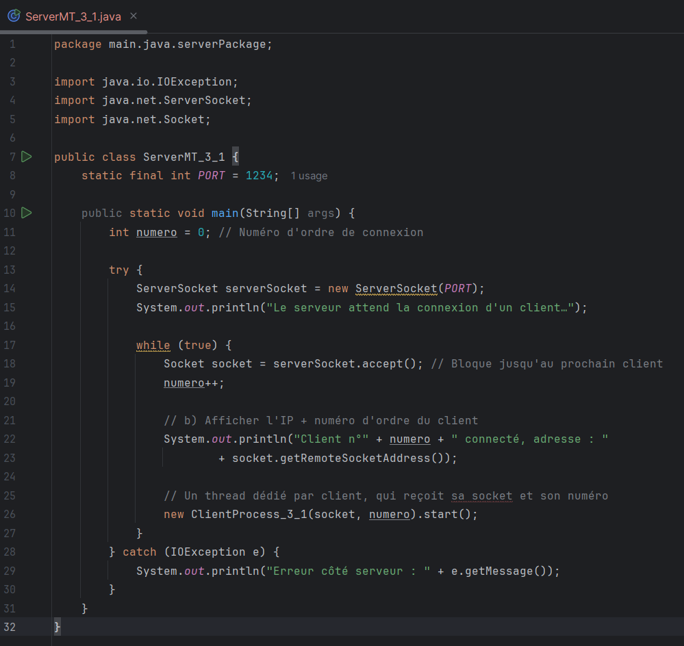
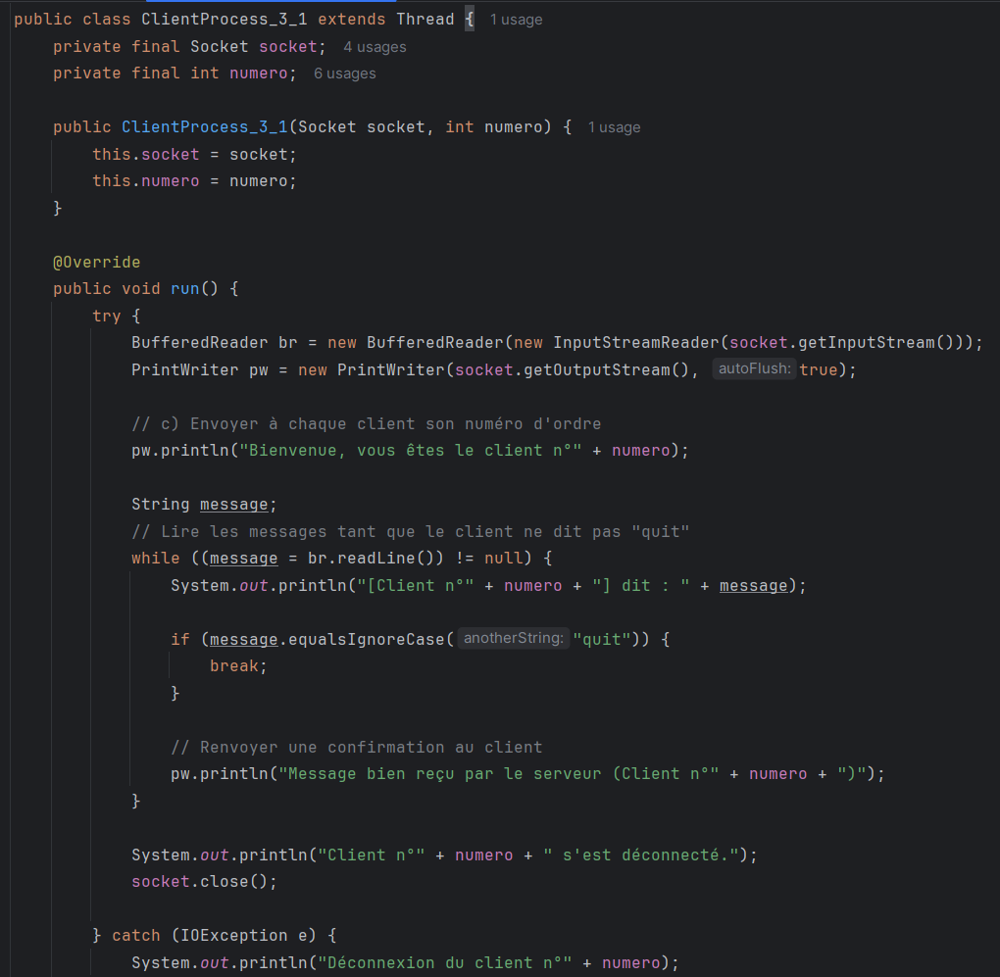
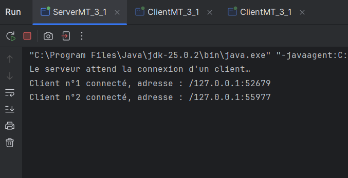
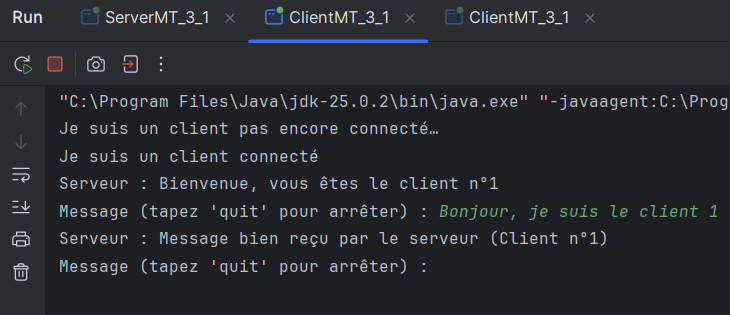
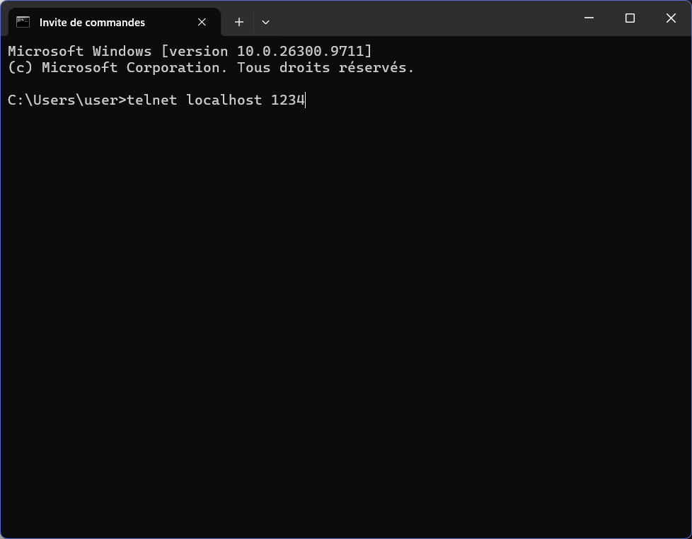
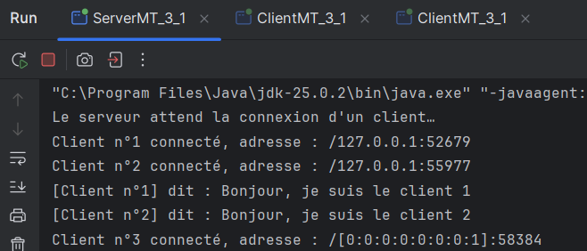

# TP3 - Serveur Multi-threads (Sockets TCP)

**Étudiant :** Chayma Bouassida  
**Matière :** Développement d'applications réparties  
**Année universitaire :** 2026 – 2027

Ce dépôt contient le travail du TP3 portant sur la création d'un serveur multi-thread capable de gérer plusieurs clients simultanément, avec une communication par texte (Activité 3-1) et par objets avec gestion d'accès concurrent (Activité 3-2).

---

# Activité 3-1 : Acceptation de plusieurs clients

## Objectif
Modifier le serveur pour qu'il puisse accepter plusieurs clients simultanément. Pour chaque client, le serveur affiche son adresse IP, son numéro d'ordre de connexion, et lui envoie ce même numéro.

## Architecture de l'application
- **`ServerMT_3_1.java`** : La classe principale du serveur. Elle utilise une boucle `while(true)` pour accepter les connexions en continu via `ServerSocket.accept()`.
- **`ClientProcess_3_1.java`** : Une classe qui hérite de `Thread`. Elle est instanciée pour chaque nouveau client afin de gérer la communication de manière indépendante.
- **`ClientMT_3_1.java`** : Le client qui se connecte au serveur, reçoit son numéro d'ordre, et peut envoyer des messages.

## Code Source
### ServerMT_3_1.java

### ClientProcess_3_1.java

### ClientMT_3_1.java

## Tests et Résultats
### 1. Test avec plusieurs clients Java
Le serveur accepte les clients et affiche leurs adresses IP et numéros d'ordre.

Les clients reçoivent leur numéro et peuvent échanger des messages.

### 2. Test avec Telnet
Un client Telnet a pu se connecter au serveur, qui lui a attribué le numéro 3.

## Synthèse (3-1)
Le serveur utilise une boucle infinie pour ne jamais s'arrêter d'écouter. À chaque connexion, le serveur crée un nouveau Thread (`ClientProcess_3_1`). Cela permet au thread principal de rester bloqué sur `accept()` pour les futurs clients, tandis que les threads enfants gèrent la lecture et l'écriture des messages avec leurs clients respectifs. L'utilisation de `PrintWriter` et `BufferedReader` permet un échange de texte fluide.
