# TP3 - Serveur Multi-threads (Sockets TCP)

**Étudiant :** Chayma Bouassida  
**Matière :** Développement d'applications réparties  
**Année universitaire :** 2026 – 2027

Ce dépôt contient le travail complet du TP3 : un serveur multi-thread capable de gérer plusieurs clients simultanément, avec une communication texte (Activité 3-1) puis par objets avec un compteur synchronisé (Activité 3-2).

---

# Activité 3-1 : Acceptation de plusieurs clients

## Objectif
Créer un serveur multi-thread acceptant plusieurs clients simultanément, affichant l'adresse IP et le numéro d'ordre de chaque client.

## Code Source
### ServerMT_3_1.java

### ClientProcess_3_1.java (Le Thread)

### ClientMT_3_1.java
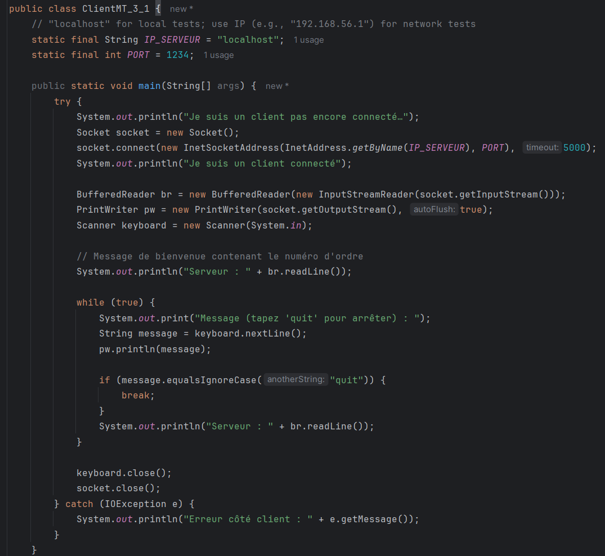

## Déroulement des tests

### 1. Démarrage du serveur
Le serveur démarre et bloque sur `accept()` en attente de clients.
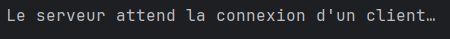

### 2. Connexion du Client 1
Le premier client se connecte et reçoit son numéro.

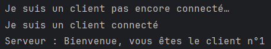

Le serveur détecte la connexion (IP + n°1).

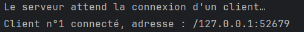

### 3. Connexion du Client 2
Le second client se connecte simultanément et reçoit son numéro.
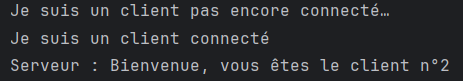

Le serveur montre les deux clients connectés en parallèle.
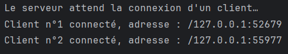

### 4. Échange de messages
Le Client 1 envoie un message au serveur.
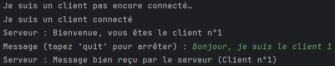

Le Client 2 envoie un message au serveur.
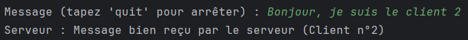

Le serveur reçoit et affiche les messages des deux clients sans se bloquer.
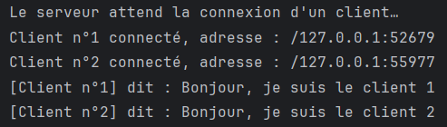

### 5. Test avec Telnet (Client 3)
Pour prouver que le serveur accepte n'importe quel client, on utilise Telnet.

Le serveur envoie le message de bienvenue à Telnet.
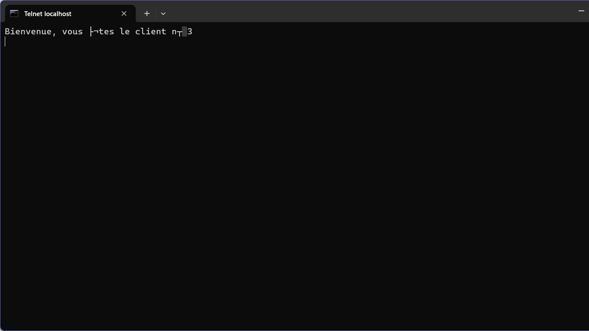
Le serveur affiche la 3ème connexion (Client n°3).
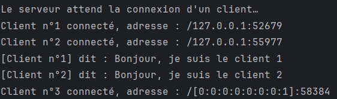

## Synthèse (3-1)
Le serveur utilise une boucle `while(true)` couplée à `ServerSocket.accept()`. À chaque nouvelle connexion, un nouveau Thread (`ClientProcess_3_1` héritant de `Thread`) est instancié. Le thread principal reste donc disponible pour accepter d'autres clients. L'échange de texte se fait via `PrintWriter` et `BufferedReader`.
